# openAntennaValidation

Compare la réception de deux à dix antennes HF en mesurant, sur les mêmes signaux et au même moment, le niveau reçu (RSSI), le plancher de bruit et le rapport signal sur bruit (SNR). Les campagnes durent de 1 minute à 1 mois ; les résultats sont consultables sur la page locale de la station et, si l'opérateur le souhaite, publiés sur un site WordPress commun à plusieurs opérateurs.

**Présentation du projet** (méthode, état d'avancement, participation) : [docs/presentation.md](docs/presentation.md).



- Cahier des charges : [docs/cahier-des-charges.md](docs/cahier-des-charges.md)
- Décisions et écarts : [docs/decisions.md](docs/decisions.md)
- Maquettes de l'interface : [design/](design/)

État : phase P5. Une station en mode commuté (un SDR à deux entrées) qualifie sa commutation, décrit ses antennes et leurs chaînes, puis mène des campagnes de mesure sur des fréquences imposées, de 1 minute à 1 mois, consultables pendant et après la mesure. En bande automatique, le programme relève la bande, choisit lui-même ses signaux et les réévalue. En mode simultané, chaque antenne a son SDR (2 à 10) : un test de charge vérifie que l'ordinateur suit, une campagne A/A étalonne l'ensemble.

## Deux façons de comparer

- **Mode commuté** : un seul SDR à plusieurs entrées (RSP2 Pro : A et B), commuté rapidement entre les antennes.
- **Mode simultané** : un SDR par antenne (2 à 10), étalonnés entre eux, à l'écoute de la même bande au même instant.

## Prérequis

- Python 3.11 ou plus récent.
- Matériel de référence : SDRplay RSP2 Pro. Aussi, en mode simultané : RTL-SDR Blog V4 et Airspy HF+ Discovery.
- Pour un SDRplay : API SDRplay 3.x, à télécharger sur le [site de SDRplay](https://www.sdrplay.com/downloads/). Elle est propriétaire et ne peut pas être fournie avec ce logiciel. Son service (`SDRplayAPIService` sous Windows) doit tourner.
- Pour une RTL-SDR Blog V4 : librtlsdr de la [branche RTL-SDR Blog](https://github.com/rtlsdrblog/rtl-sdr-blog/releases) (`rtlsdr.dll` et `libusb-1.0.dll` sous Windows, avec le pilote WinUSB installé par Zadig). Chaque clé doit avoir un numéro de série unique (`rtl_eeprom -s`).
- Pour un Airspy HF+ : [libairspyhf](https://github.com/airspy/airspyhf/releases) (`airspyhf.dll` sous Windows).
- Sous Windows, si la bibliothèque n'est pas dans le `PATH`, indiquez son chemin dans `library_path` de la section du pilote (`[hardware.rtlsdr]`, `[hardware.airspyhf]`).

## Installation

**Debian 12+ / Raspberry Pi OS 64 bits** : installez l'API SDRplay (ou déposez son installeur `.run` dans votre dossier personnel), puis :

```bash
sudo ./install/linux/install.sh                        # SDRplay
sudo ./install/linux/install.sh --sdr rtlsdr           # RTL-SDR Blog V4 (librtlsdr compilée)
sudo ./install/linux/install.sh --sdr airspyhf,rtlsdr  # Airspy principal, plus des RTL-SDR
```

Relancé sans `--sdr`, l'installeur reprend les SDR de la configuration existante.

**Windows (développement, en attendant l'installeur de la phase P9)** :

```powershell
py -3.12 -m venv .venv
.\.venv\Scripts\pip install -e ".[dev]"
.\.venv\Scripts\oav init          # crée la configuration, la base et demande le mot de passe
.\.venv\Scripts\oav serve         # page web sur http://localhost:8660/
```

Sans matériel, `oav init --driver simulated` utilise un SDR simulé à deux entrées (porteuses, SSB, FT8, évanouissement, bascule réaliste).

Le répertoire de la station (configuration, base, journaux) est `%PROGRAMDATA%\open-antenna-validation` sous Windows, `~/.local/share/open-antenna-validation` sous Linux (`/var/lib/open-antenna-validation` pour le service installé). On peut le changer avec `--home` ou la variable `OAV_HOME`.

## Commandes

| Commande | Rôle |
| --- | --- |
| `oav init [--driver sdrplay\|rtlsdr\|airspyhf\|simulated]` | Crée la configuration (identifiant de station, secret de session), la base, le mot de passe |
| `oav set-password` | Change le mot de passe de la page web |
| `oav detect` | Liste les SDR détectés (de chaque pilote de la station) et leurs entrées |
| `oav probe [--frequency 7.1e6] [--gain-step N]` | Ouvre le SDR, mesure niveau, plancher et écrêtage sur chaque entrée |
| `oav serve` | Lance le service et la page web |

## Plusieurs SDR (mode simultané)

Le SDR principal est décrit dans la section `[hardware]` de `config.toml` ; les autres s'ajoutent dans la liste `others`, par numéro de série (affiché par `oav detect`) :

```toml
[hardware]
driver = "sdrplay"
serial = "1234567890"
antenna = "A"
others = [
    { serial = "2345678901", antenna = "A" },
]
```

Avec des RTL-SDR ou des Airspy HF+, mettez `driver = "rtlsdr"` ou `driver = "airspyhf"` ; un SDR de la liste peut aussi avoir son propre pilote (`{ serial = "3B52AB5DAC5A7E91", driver = "airspyhf" }`). Chaque SDR prend sa plus basse fréquence d'échantillonnage possible au-dessus de `sample_rate` (250 kS/s par défaut) ; pour couvrir toute la bande des 10 m avec des RTL-SDR, mettez `sample_rate = 2400000`.

Chaque SDR a son propre processus d'acquisition. Avant la première campagne, faites une campagne A/A (la même antenne sur tous les SDR par un splitter) : elle mesure l'écart de gain de chaque SDR et les marges. Les SDR doivent rester branchés sur les mêmes ports et dans le même ordre de voies pour que l'étalonnage s'applique.

## Publication sur un site WordPress

Le plugin `open-antenna-validation` (dossier `wordpress/`, zip produit par `python wordpress/build.py --zip`) rassemble les campagnes de plusieurs opérateurs sur un site, hébergement mutualisé compris :

1. Sur le site : installer et activer le plugin ; créer une page contenant `[oav_campagnes]` (et, si besoin, une page `[oav_stations]`) ; dans **Antennes HF › Réglages**, choisir cette page, le quota et la taille maximale d'une campagne. Les opérateurs sont validés dans **Antennes HF › Opérateurs**.
2. L'opérateur crée sa station dans **Antennes HF › Stations** : le jeton s'affiche une seule fois.
3. Sur la station : page **Installation**, section « Publication sur le site » : adresse du site et jeton, puis « Tester la liaison ».
4. Au lancement d'une campagne, cocher « Publier cette campagne sur le site ». La station envoie les médianes par fenêtre et la description de l'installation, jamais de mesure brute ; le locator est réduit à 4 caractères.

La station envoie elle-même ses données : le site n'a jamais besoin d'accéder à la station. Une coupure réseau de plusieurs jours ne perd rien.

## Sécurité

La page écoute par défaut sur le réseau local (port 8660), protégée par mot de passe (argon2) et cookie de session. Ne l'exposez pas directement sur Internet : passez par un VPN.

## Licence

GPLv3 ou ultérieure (voir [LICENSE](LICENSE)). Polices IBM Plex sous licence SIL OFL 1.1 ([web/vendor/fonts/OFL.txt](web/vendor/fonts/OFL.txt)), ECharts sous licence Apache 2.0.
