# Présentation du projet de mesures comparatives d'antennes

**openAntennaValidation** compare la réception de plusieurs antennes HF, sur de longues durées, avec une méthode qui dit aussi ce qu'elle ne sait pas. Logiciel libre (GPLv3), conçu par et pour des radioamateurs.

## Le problème

Comparer deux antennes « à l'oreille » ou sur quelques minutes ne prouve presque rien. La propagation change d'une minute à l'autre, le fading peut atteindre 20 dB, le bruit local varie avec l'heure, et une antenne meilleure le jour en NVIS peut être moins bonne la nuit en DX. Pour savoir laquelle reçoit le mieux, il faut **mesurer les deux en même temps, longtemps, sur des signaux réels**, et ne conclure que lorsque l'écart dépasse l'erreur de la méthode.

## Ce que fait le logiciel

- Il écoute une bande HF avec un récepteur SDR et mesure, pour chaque antenne, le **niveau reçu (RSSI)**, le **plancher de bruit** et le **rapport signal sur bruit (SNR)** de chaque signal.
- Les mesures durent **d'une minute à un mois**, jour et nuit, pour voir l'effet de la propagation.
- Il compare **de 2 à 10 antennes**, toujours par rapport à une antenne de référence.
- Il ne démodule rien : il mesure de la puissance dans la largeur de chaque signal.

Bandes prévues : toutes les bandes radioamateur de 3 à 30 MHz, la CB (26 à 28 MHz), et les bandes de radiodiffusion 45 m et 85 m.

## Deux façons de comparer

**Réception commutée** : un seul SDR à plusieurs entrées (par exemple le SDRplay RSP2 Pro, entrées A et B) bascule très vite d'une antenne à l'autre, plusieurs dizaines de fois par seconde. Le même récepteur mesure les deux antennes : pas d'écart de gain entre récepteurs. Un banc de qualification mesure ce que coûte chaque bascule ; certains signaux (la voix en SSB) varient trop vite pour ce mode, et le logiciel le dit.

**Réception simultanée** : un SDR par antenne, tous à l'écoute au même instant. Toutes les classes de signal sont mesurables, mais les récepteurs doivent être **étalonnés entre eux en amont** : une campagne « A/A » branche la même antenne sur tous les SDR par un splitter ; l'écart vrai est nul, ce qui reste est l'écart relatif de chaque récepteur à celui de référence, corrigé ensuite dans les mesures. Un test de charge vérifie que l'ordinateur suit avant chaque campagne.

## Fréquences imposées ou bande automatique

On peut donner soi-même les fréquences à mesurer (une balise, une station de radiodiffusion, une fréquence FT8), ou une portion de bande : le logiciel relève alors la bande, **choisit lui-même les signaux** (porteuses, signaux numériques, SSB, AM), garde un point de bruit, et réévalue la bande toutes les heures. Quand la bande est calme (la nuit sur 28 MHz), il ralentit les mesures sans s'arrêter.

## Les modes numériques : savoir qui l'on reçoit

Sur les sous-bandes FT8, FT4 et WSPR, la station **décode les messages** avec les programmes de WSJT-X. Elle sait alors qui émet, d'où, à quelle distance et dans quelle direction. Chaque station reçue est suivie tout au long de ses échanges, puis validée ou écartée (collision, saut de fréquence, trop peu de mesures…).

Le message décodé est réencodé : on connaît le ton émis à chaque instant, et le niveau est mesuré sur ce seul ton, le bruit sur les tons voisins. La mesure reste précise même au seuil de décodage. Avec plusieurs SDR, une station décodée sur une seule antenne est mesurée aussi sur les autres : on voit ce que la meilleure antenne entend et que l'autre manque.

On obtient l'écart entre antennes **station par station**, puis selon la distance (onde de sol, NVIS, un bond, plusieurs bonds), l'angle de départ estimé et la direction : une carte centrée sur la station, et un diagramme polaire qui montre le lobe d'une antenne directive.

## Une méthode qui chiffre son incertitude

- **Qualification du matériel** : banc de mesure du récepteur en mode commuté, campagne A/A dans les deux modes. Chaque campagne porte ses **marges d'erreur par classe de signal**.
- **Codes qualité** : mesures saturées, flux interrompu, récepteurs désalignés dans le temps : écartées et comptées, jamais corrigées en silence. Les mesures brutes ne sont jamais modifiées.
- **Statistiques** : l'écart entre antennes est une médiane sur des fenêtres de temps ; son intervalle de confiance est calculé par **bootstrap par blocs**, parce que deux mesures voisines se ressemblent et qu'un calcul naïf serait trop optimiste. Au-delà de deux antennes, la **correction de Holm** évite de trouver par hasard des écarts entre certaines des 45 paires possibles.
- **Règle de conclusion** : un écart n'est affirmé que s'il dépasse la marge de qualification **et** que l'intervalle de confiance exclut zéro. Sinon, la page le dit : « pas d'écart significatif ».
- **Installation décrite** : hauteur, polarisation et orientation de chaque antenne, pertes de chaque câble, balun ou relais. La vue « Antenne » retire les pertes de la chaîne pour comparer les antennes elles-mêmes.

## Les résultats

Chaque campagne a sa page : résumé rédigé automatiquement, écart sur 24 heures selon l'heure solaire (NVIS de jour, DX de nuit), écart par période du jour, jour par jour, dans le temps et par signal, matrice des paires au-delà de deux antennes, qualité des données. La même page s'affiche sur l'ordinateur de la station et sur le site.

## Le site : plusieurs stations, plusieurs opérateurs

Les opérateurs qui le souhaitent publient leurs campagnes sur ce site. La station envoie elle-même ses résultats ; le site n'accède jamais à la station. Ce qui est publié : les médianes par fenêtre de temps et la description de l'installation. **Jamais de mesure brute, jamais d'enregistrement du signal, et la position réduite à un carré locator de 4 caractères** (environ 100 km).

La liste des campagnes se filtre par opérateur, bande, paire de types d'antennes (dipôle contre verticale, par exemple), mode de réception, récepteur et période. Tant qu'aucune vraie campagne n'est publiée, deux campagnes de démonstration (données simulées, marquées comme telles) montrent à quoi ressemblent les résultats.

## Matériel

- **SDRplay RSP2 Pro** : récepteur de référence, mode commuté (deux entrées) et simultané.
- **RTL-SDR Blog V4** : mode simultané, une clé par antenne, jusqu'à 28,8 MHz (au-delà, la clé change d'entrée). Clé économique, dynamique limitée (8 bits). Chaque clé doit avoir son propre numéro de série. Les autres clés RTL-SDR ne sont pas acceptées : elles ne reçoivent les ondes courtes que sans réglage de gain.
- **Airspy HF+ Discovery** : mode simultané, un appareil par antenne. Excellent en ondes courtes, bande utile d'environ 200 kHz à la fréquence d'échantillonnage par défaut.
- Les modèles peuvent être mélangés en mode simultané ; la campagne est alors marquée « hétérogène » et l'étalonnage A/A chiffre l'écart entre récepteurs.
- Un ordinateur sous Linux (Debian 12 ou plus récent, Raspberry Pi OS 64 bits), recommandé pour les campagnes longues, ou sous Windows 10/11. Plusieurs SDR en simultané demandent un processeur à plusieurs cœurs : le test de charge le vérifie.

## Où en est le projet

| Étape | État |
| --- | --- |
| Maquettes de l'interface | Faites |
| Socle : récepteur, spectre en direct, base de données | Fait, en attente d'essai sur RSP2 Pro |
| Qualification du matériel (banc, campagne A/A) | Faite, en attente d'essai sur RSP2 Pro |
| Mesure en réception commutée, fréquences imposées | Faite avec le simulateur, en attente d'essai sur RSP2 Pro |
| Bande automatique | Faite avec le simulateur |
| Réception simultanée (2 à 10 SDR) | Faite avec le simulateur, en attente d'essai sur plusieurs SDR |
| Pages de résultats, statistiques, export CSV | Faites |
| Site WordPress multi-opérateurs | Fait |
| RTL-SDR V4 et Airspy HF+ | Faits, en attente d'essai sur les récepteurs |
| Installeurs Windows et Linux | Faits : Linux essayé sur Debian 12 et 13 ; Windows en attente d'essai |
| Modes numériques (FT8, FT4, WSPR) : suivi des stations, distance, propagation | Faits avec le simulateur, en attente d'essai sur l'air |

Tout ce qui est marqué « avec le simulateur » fonctionne de bout en bout avec un récepteur simulé ; les essais sur récepteurs réels sont en cours.

## Participer

- **Code source, documentation, suivi** : [github.com/Bob56fr/openAntennaValidation](https://github.com/Bob56fr/openAntennaValidation).
- **Publier vos campagnes** : demandez un compte d'opérateur sur ce site ; une fois validé, vous créez votre station et recevez son jeton.
- **Retours d'expérience** : les questions, résultats surprenants et propositions sont les bienvenus sur GitHub (onglet « Issues »).

*Page tenue à jour avec le projet, sur GitHub : docs/presentation.md.*
